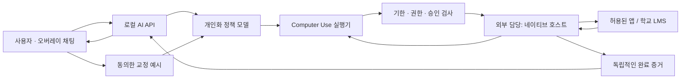

# AI 구조와 확장 지점

## 역할

`policy.py`는 목표·맥락·성공 조건·남은 시간·승인 예시를 구조화된 계획으로 바꿉니다. 기본 공급자는 OpenRouter이며 공통 모델은 `OPENROUTER_MODEL`, 역할별 모델은 `OPENROUTER_POLICY_MODEL`과 `OPENROUTER_COMPUTER_MODEL`로 지정합니다. 정책 모델은 텍스트 계획을 만들며 화면 조작 모델과 같은 모델일 필요가 없습니다.

`openrouter.py`는 표준 라이브러리 HTTP로 OpenRouter Chat Completions를 호출합니다. 이미지 관찰 → 일반 함수 호출 → 허용된 조작 → 새 관찰 루프를 관리합니다. 모델별 네이티브 computer 도구에 의존하지 않습니다. `computer_action`, `progress`, `finish`만 노출하며 조작을 병렬로 실행하지 않습니다.

`driver.py`는 모델과 독립적인 컴퓨터 조작을 오버레이 RPC로 변환합니다. 기존 OpenAI SDK 경로와도 호환됩니다. 화면 기반 조작만 전달하며 임의 셸 실행 기능을 제공하지 않습니다. OS 제어 자체는 네이티브 호스트가 구현합니다. 현재 실제 OS 어댑터는 제공하지 않으며 `rehearsal.py`의 Playwright 호스트는 가상 과제함에 한정된 통합 테스트용입니다.

`engine.py`는 한 작업의 생명주기를 관리합니다. 실시간 메시지가 오면 다음 조작 경계에서 계획과 실행 루프를 새로 시작합니다. 실행 환경은 호스트가 유지하므로 새 관찰에서 이어갑니다. UI가 이미 바뀐 상태에서 과거 클릭을 재생하지 않습니다.

## 마감

작업은 타임존을 포함한 절대 마감을 받습니다. 시작 시 UTC 시각과 비교해 남은 시간을 계산한 후 단조 시계로 소모 시간을 측정합니다. 기본 검토 예비 시간은 300초입니다. 예비 시간에 도달하면 새 부작용을 중단하며, 이미 준비한 결과를 확인하는 검증은 실제 마감까지만 허용합니다.

기본 한도는 컴퓨터 조작 160회, 실행 루프당 모델 요청 48회, 사용자 메시지 50개, 재계획 최대 5회입니다. 모델 HTTP 요청은 30초 타임아웃·자동 재시도 없음입니다. 네이티브 요청도 기본 30초 제한입니다. 이 한도는 달러 단위 지출 상한을 의미하지 않습니다.

필수 산출물부터 저장하도록 프롬프트에 지시하며, 실제 저장은 호스트/앱의 결과로 확인해야 합니다. 일반 앱에서 초안 저장까지 실패했는데 백엔드가 파일을 만들었다고 보고하지 않습니다. 리허설은 저장 버튼을 누르는 즉시 `draft.txt`로 체크포인트를 만듭니다.

## 여러 상황에 대응하기

일반 프롬프트는 고정된 앱 클릭 순서 대신 관찰, 누락 확인, 재계획, 질문, 인계 규칙을 정의합니다. 과제 제출은 첫 `task_family`입니다. 향후 메일 정리·문서 정리·웹 반복 업무도 같은 작업 스키마를 사용할 수 있습니다. 필요한 확장 지점은 다음과 같습니다.

1. 작업별 성공 조건: 예를 들어 메일은 지정한 초안 존재, 파일 정리는 이동한 경로와 파일 수입니다.
2. 앱별 네이티브 호스트: preflight에서 실제 효과를 판별하고 verify에서 결과를 읽어야 합니다.
3. 개인화 예시: 작업 종류별 교정 계획과 사용자 선호를 기록합니다.
4. 평가 사례: 정상 진행 외에 로그인 만료, 파일 누락, 접수증 미표시, 과목 혼동, 마감 임박도 포함합니다.

사용자 맥락이 비어 있거나 권한이 없는 상황을 프롬프트로 해결했다고 가정하지 않습니다. `needs_input` 또는 `handoff`가 정상적인 결과입니다. 실제 LMS가 확인되면 그 환경으로 작게 검증한 뒤 범위를 넓힙니다.

## 로컬 기록과 재시작

`data/runs/<id>/`에는 작업 입력, 최종 상태, 계획, 이벤트, PNG 스크린샷이 저장됩니다. 키는 저장하지 않습니다. 화면·과제 내용은 로컬 민감 자료일 수 있으므로 필요한 기록만 유지하세요. 기본 live 모드에서 화면과 텍스트는 OpenRouter 및 선택된 모델 제공자에게 전달됩니다. OpenAI 직접 경로를 선택하면 OpenAI API로 전달됩니다. 학습 내보내기는 별도 동의와 별도 명령을 거치며 자동 업로드하지 않습니다.

실행 중 상태는 메모리에 있습니다. 프로세스 재시작 후 같은 작업을 자동 재개하지 않습니다. 중간에 외부 제출이 끝났는지 먼저 관찰해야 하므로 로그의 클릭을 재생하면 안 됩니다. 이 버전에서는 새 작업으로 결과를 확인하고 이어갑니다.
